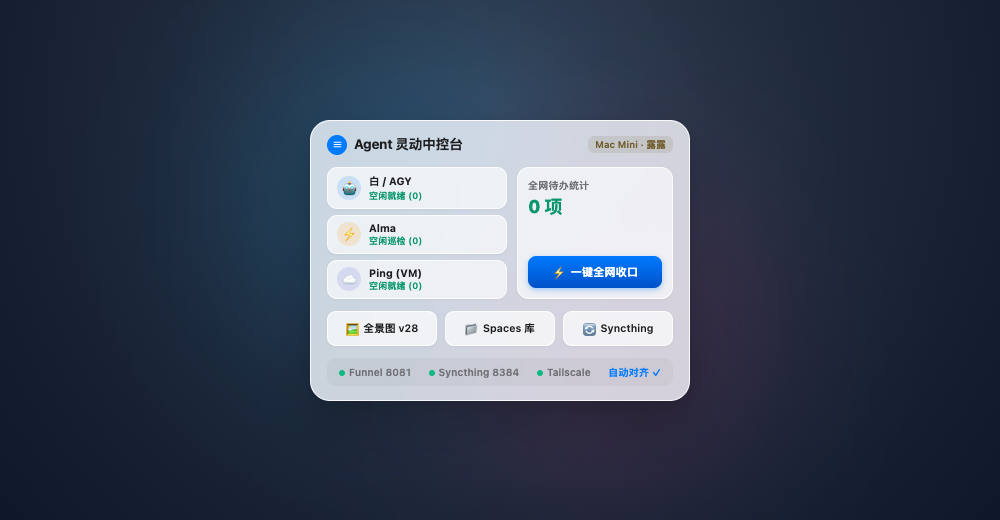

<div align="center">

# 🏝️ AgentIsland

**Apple Liquid Glass Control Center & Dynamic Island for Multi-Agent Orchestration**  
**苹果原生液态玻璃 · 多智能体灵动中控台**

[](https://www.apple.com/macos/)
[](https://swift.org)
[](LICENSE)
[](https://github.com/Sputnik5277/AgentIsland)

<br/>

[English](#english) • [简体中文](#简体中文)

<br/>


</div>

---

<a name="english"></a>
## English

### Overview

**AgentIsland** is a native macOS status capsule and Control Center crafted for multi-agent workflows. Engineered with pure Swift 6 and AppKit, it looks and feels like an authentic macOS Sequoia / VisionOS system component.

It solves the visibility and control bottleneck when orchestrating multiple coding agents (e.g., Claude Code, OpenAI Codex, Antigravity, local daemons) across machines.



### Key Features

- 💎 **Apple Liquid Glass Design**: Authentic system frosted glass using native `NSVisualEffectView`, providing real-time backdrop blur and razor-sharp specular highlights.
- 🎛️ **1:1 Control Center Layout**: Squircle modules patterned directly after the macOS Control Center grid.
- 🩺 **Interactive Channel Self-Healing**: Click red channel dots to auto-launch or restart background sync daemons (Nutstore, Funnel 64M, Tailscale).
- 📂 **Direct Agent Inbox Drilldown**: Click any agent pill to instantly open its handoffs inbox folder in Finder.
- 🕒 **Done Feed & Reply Accountability**: Unfurl any agent drawer to inspect the last 3 completed handoffs with completion timestamps and 1-click reply verification in Obsidian.
- ⚡ **1-Click Sweep Action**: Instantly marks completed tasks and syncs the shared ledger across 5 agent boxes with a single click—no CLI needed.
- 🖱️ **First-Mouse Single-Click Responsiveness**: Custom `FirstMouseHostingView` ensuring immediate 1-click activation without macOS first-mouse swallow.
- 🖥️ **Active Display Tracking**: Automatically follows active mouse cursor focus across multi-monitor setups (e.g. 4K/2K external displays).
- 🌓 **Instant Theme Adaptation & Accent Palette**: Native status menu supporting System / Light / Dark modes plus a 5-color accent palette (Blue, Purple, Yellow, Green, Red) with permanent UserDefaults persistence.
- 🛡️ **Zero Token & 100% Offline**: Pure local file and port polling. Uses zero LLM tokens and ~15MB RAM.

### Quick Start

#### Build from Source
```bash
git clone https://github.com/Sputnik5277/AgentIsland.git
cd AgentIsland
./build.sh
```
The compiled binary will be located in `dist/AgentIsland.app` and zipped as `dist/AgentIsland-macOS-arm64.zip`.

#### Install
```bash
cp -R dist/AgentIsland.app /Applications/
open /Applications/AgentIsland.app
```

---

<a name="简体中文"></a>
## 简体中文

### 项目简介

**AgentIsland** 是一套专为多智能体（Multi-Agent）跨端协同打造的 macOS 原生灵动中控台。采用纯原生 Swift 6 与 AppKit 深度定制，100% 还原 macOS Sequoia / VisionOS 原厂透亮水晶液态玻璃美学。

解决在同时调度多端 Agent（云端沙箱、本地守护进程、前台大模型）时“黑盒无感知”、“必须反复敲命令行查进度”的痛点。

### 核心特性

- 💎 **苹果原厂液态玻璃**：底层调用硬件加速 `NSVisualEffectView` 实时折射背景，搭配 1.0px 水晶切面内高光，通透纯净。
- 🎛️ **1:1 苹果控制中心网格**：完全复刻 macOS 经典 Squircle 圆角胶囊模块，信息层次分明。
- 🩺 **通道红灯点击自愈**：通道异常红灯时点击直接唤起启动或热启服务（坚果云自动唤醒 / Funnel 一键热启 / Tailscale 跳转）。
- 📂 **智能体收件箱一秒下钻**：点击白 / Alma / Ping 药丸卡片，一键在 Finder 中打开对应待办收件箱目录，待办单单一清二楚。
- 🕒 **最新结案回信 · 已办结流 (Done Feed)**：点击任意 Agent 展开抽屉，不仅能看待办，还能一眼看清最近 3 笔已结案回信的标题、完成时间与发件人，并支持一键在 Obsidian 中打开回信全文核查，成果一清二楚。
- ⚡ **一键全网核验与归档**：点击金刚键，后台自动跨箱穿透回信并核销台账，同时对超过 3 天的历史已结案单据自动退火归档至冷区，待办瞬间归零。
- 🪙 **Antigravity 双核遥测底座**：无锁非侵入式接入本地 Token 账本，实时掌握本月 Token 消耗、Cache 命中率与主力模型分布。
- 🖱️ **首击直达（First-Mouse）**：攻克 macOS 原生悬浮窗首击吞咽问题，单击即开、防抖不抽搐，失焦或按 `Esc` 丝滑收拢。
- 🖥️ **活跃屏幕智能跟随**：精准检测鼠标当前所在的外接显示器（如 4K 宽屏），胶囊自动平滑就位，绝不跑飞。
- 🌓 **状态栏两级外观与 5 色调色盘**：点击状态栏图标直接切换「⚙️ 跟随系统 / ☀️ 浅色白瓷 / 🌙 深色黑曜石」，并支持 5 档主题强调色（经典蓝 / 极光紫 / 琥珀黄 / 薄荷绿 / 珊瑚红），即点即变且自动持久化。
- 🛡️ **零 Token 纯本地运行**：纯 Python / Swift 底层读取本地台账与端口，0 API 消耗，极低 CPU 占用（内存约 15MB）。

### 快速开始

#### 源码极速构建
```bash
git clone https://github.com/Sputnik5277/AgentIsland.git
cd AgentIsland
./build.sh
```
构建脚本将在 `dist/` 目录下生成 `AgentIsland.app` 以及发布压缩包 `AgentIsland-macOS-arm64.zip`。

#### 本地安装与启动
```bash
cp -R dist/AgentIsland.app /Applications/
open /Applications/AgentIsland.app
```

---

## 架构分层 (Architecture)

```text
AgentIsland Architecture:
┌─────────────────────────────────────────────────────────────┐
│ 1. Core State Engine (纯逻辑状态引擎 · 0 UI 依赖)           │
│    - HandoffInboxScanner (读取各节点待办与 .ack 核销台账)    │
│    - ChannelProbe (Funnel / Syncthing 本地端口毫秒级探测)    │
├─────────────────────────────────────────────────────────────┤
│ 2. Window Controller (多屏动态控制器 · AppKit)              │
│    - ActiveScreenFollower (基于光标所在屏动态重定位)        │
│    - AutoDismissMonitor (失焦与点击外部自动收起)            │
│    - Level: .statusBar + .canJoinAllSpaces 全屏穿透        │
├─────────────────────────────────────────────────────────────┤
│ 3. Liquid Glass Morphing UI (液态流体视觉层 · SwiftUI)       │
│    - AppleGlassBackground (系统级原生背底虚化折射)           │
│    - Dual-Mode Design Tokens (严格对齐深浅两套色彩令牌)      │
│    - Control Center Squircle Grid (模块化网格中控面板)      │
└─────────────────────────────────────────────────────────────┘
```

---

## 许可证 (License)

本项目采用 [MIT License](LICENSE) 开源许可证。
