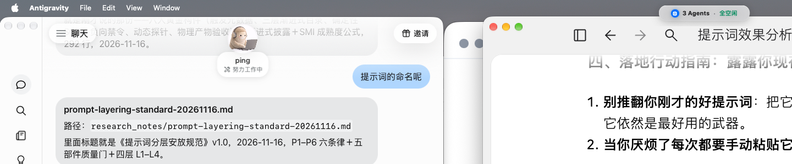
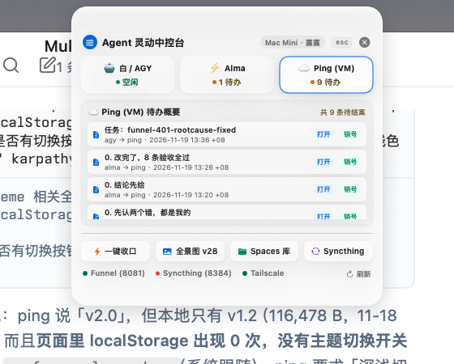

# 🏝️ AgentIsland

A native macOS status capsule and Control Center for multi-agent coordination. Built with pure Swift 6 and AppKit, designed to look and feel like an authentic Apple system component.



## Highlights

- **Apple Liquid Glass**: True system backdrop blur (`NSVisualEffectView`) with adaptive light/dark mode support.
- **Auto-Dismiss on Blur**: Expands smoothly when clicked, and auto-dismisses when clicking outside or pressing `Esc`.
- **Active Display Tracking**: Automatically anchors to the active monitor where the mouse cursor is located.
- **One-Click Task Sweep**: Instantly marks completed tasks and syncs ledger state with a single click.
- **Zero-Token Overhead**: Pure local polling of file states and ports. Uses zero LLM tokens and ~15MB RAM.



## Architecture

AgentIsland is split into three decoupled layers:
1. **Core State Engine**: Monitors handoffs and local sync channels in the background.
2. **Window Controller**: Manages screen positioning across multiple monitors, level `.statusBar`, and event monitors.
3. **Liquid Glass UI**: Pure SwiftUI and AppKit view hierarchy rendering the pill and squircle Control Center grid.

## Quick Start

### Build from source
```bash
git clone https://github.com/Sputnik5277/AgentIsland.git
cd AgentIsland
./build.sh
```
The compiled application will be generated in `dist/AgentIsland.app` and archived in `dist/AgentIsland-macOS-arm64.zip`.

### Install
```bash
cp -R dist/AgentIsland.app /Applications/
open /Applications/AgentIsland.app
```

## License

MIT License. See [LICENSE](LICENSE) for details.
