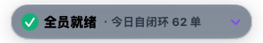

<div align="center">

# 🏝️ AgentIsland

**Apple Liquid Glass Control Center & Dynamic Island for Multi-Agent Orchestration**  
**苹果原生液态玻璃 · 多智能体灵动中控台**

[](https://www.apple.com/macos/)
[](https://swift.org)
[](LICENSE)
[](https://github.com/Sputnik5277/AgentIsland)

<br/>

[English](#english) • [简体中文](#简体中文)

<br/>



</div>

---

<a name="english"></a>
## English

### Overview

**AgentIsland** is a native macOS status capsule and Control Center crafted for multi-agent workflows. Engineered with pure Swift 6 and AppKit, it looks and feels like an authentic macOS Sequoia / VisionOS system component.

It solves the visibility and control bottleneck when orchestrating multiple coding agents (e.g., Claude Code, OpenAI Codex, Antigravity, local daemons) across machines.


### Key Features

- 💎 **Apple Liquid Glass Design**: Real native liquid glass on macOS 26+ (`NSGlassEffectView` for the panel, SwiftUI `.glassEffect` for cards, with skin `tintColor`), falling back to `NSVisualEffectView` on older systems. Tint layers are compressed per skin so the backdrop refraction actually shows through.
- 🎛️ **1:1 Control Center Layout**: Squircle modules patterned directly after the macOS Control Center grid.
- 🩺 **Interactive Channel Self-Healing**: Click red channel dots to auto-launch or restart background sync daemons (Nutstore, Funnel 64M, Tailscale).
- 📂 **Direct Agent Inbox Drilldown**: Click any agent pill to instantly open its handoffs inbox folder in Finder.
- 🕒 **Done Feed & Reply Accountability**: Unfurl any agent drawer to inspect the last 3 completed handoffs with completion timestamps and 1-click reply verification in Obsidian.
- ⚡ **1-Click Sweep Action**: Instantly marks completed tasks and syncs the shared ledger across 5 agent boxes with a single click—no CLI needed.
- 🖱️ **First-Mouse Single-Click Responsiveness**: Custom `FirstMouseHostingView` ensuring immediate 1-click activation without macOS first-mouse swallow.
- 🖥️ **Active Display Tracking**: Automatically follows active mouse cursor focus across multi-monitor setups (e.g. 4K/2K external displays).
- 🌓 **Instant Theme Adaptation & Accent Palette**: Native status menu supporting System / Light / Dark modes plus a 5-color accent palette (Blue, Purple, Yellow, Green, Red) with permanent UserDefaults persistence.
- 🛡️ **Zero Token & 100% Offline**: Pure local file and port polling. Uses zero LLM tokens and ~15MB RAM.

### UX Redesign (2026-11-20)

- 🏝️ **Collapsed summary + hover expand**: the capsule shows one prioritized line (pending confirmations, unread counts, or all-read / channel-normal) instead of three green dots; approaching the pointer auto-expands the Control Center after 0.18s and collapses 0.7s after leaving.
- 🎨 **Fixed agent identity colors**: AGY `#0A84FF`, Alma `#FF9F0A`, Ping `#7C3AED` are used consistently across collapsed dots, overview chips, inbox cards, drawer headers, and the topology view.
- 🧱 **Three-tier channel hierarchy**: base `Tailscale` → primary `Funnel 443` → cold backup `Nutstore`, replacing the three equal-weight buttons.
- 🖱️ **Five-group context menu + merged Appearance submenu**: 中控台 / 打开 / 自检 / 外观 / 退出 groups; global hotkey **`⌥I`** (Carbon `RegisterEventHotKey`) + menu shortcuts `⌥M ⌥D ⌥K ⌥S ⌥C ⌥P ⌥F`; SF Symbols only (no emoji); one 「外观设置」 submenu covering theme, skin, form, discrete crisp scaling (`100% / 110% / 120%` — no GPU `.scaleEffect` blur on 2K 1x displays), dock edge, and accent color.
- 🔤 **Typography floor**: body text ≥13pt, secondary text ≥11pt, `.semibold` minimum, opaque text colors; crisp 1x rendering audited via `scripts/gate_app_hygiene.py` (`8/8` pre-compile checks).
- 🖼️ **Full-size AppIcon**: `.icns` with 16/32/128/256/512/1024px, declared via `CFBundleIconFile`, packaged by `build.sh`, and installed in `~/Applications/AgentIsland.app`.

### v4 Meituan Closed-Loop Control Center (2026-11-22 · `7041ea9`)

- ⌨️ **Global Toggle (`⌥I`) & Funnel Quick Send**: summon or dismiss from any app via `⌥I`; send one-line dispatches to `Ping` / `AGY` / `Alma` via `handoff.py send --from lulu` with T1 receipt toast.
- 🧭 **M4/M5/M6 Delta Telemetry & M1 Decision Banner**: consumes `~/.config/alma/state/pingloop-health.json`, `pingloop-convergence.jsonl`, and `a-verifier-decisions/*-fused.md` with >30m `isStale` guard; anti-anxiety capsule (`M1熔断 > 待验 > 今日新单 > 今日清零·存量N`) and in-card `机检 / 通过 / 打回 / 已读 / 复制`.
- 🛵 **Meituan Closed-Loop Stages & Overdue Alerts**: drawer accurately distinguishes `派单 → 接单(履约中) → 需前台接力 (Step 2.5) → 待验 → 已结案`, filters hand-written inline confirmations, highlights overdue (`超时`/`滞留`) tasks, and pins the drawer header cleanly under 100+ items.
- 📚 **Customizable M7 Quick Assets & Hygiene Gate**: 5 defaults (incl. `decisions-archive.md` & `corrections.tsv`) editable in Settings via `UserDefaults`; `build.sh` runs `scripts/gate_app_hygiene.py` (`8/8` static rules) before `swiftc`.

### Idle Zero-Line Semantics & Polling Boundary (v1.8.0)

- **No communication → no line, no pulse, no dot.** When `activePulses` is empty the topology and the mini strip draw zero connecting lines; the pulse layer is only mounted when at least one edge is active. Node rings stay visible at ≥2.2:1 contrast in their weakened idle state.
- **2-second polling has a blind spot.** The event feed is sampled every 2s and aggregated over a 15s window. An event that arrives and ages out between two samples, or lands in a missed log line, can be absent from the topology — the view only claims what was actually sampled. The handoff files themselves remain the source of truth.
- **Pulse shape**: one dot per active edge, shared 2.4s period, radius 3, a single 4px glow; two concurrent edges show as two dots, never a chain.

### v2.0.0 Major Upgrade — Ping-Loop Live Fusion & Tabbed Control Center (2026-11-23)

- **Compact 4-Tab Control Center (Zero-Emoji, Native Liquid Glass Preserved)**: replaces long vertical stacking with 4 fixed-height tabs — **Team** (4-column ambient presence for `Ping / AGY / Alma / Simulation PC`), **Feed** (today's auto-closeout human-readable timeline from `events.log`), **Self-Harness** (zero-click autonomous upgrade/prune change log), and **Topology**.
- **Orthogonal Straight-Line Physical Topology**: renders real physical routing with orthogonal lines — `Ping → Funnel 443 → Mac Mini (AGY — 0ms bus — Alma) → LAN → Simulation PC`, plus a dedicated straight horizontal bottom line for `Ping ━━━━ Simulation PC` (`Tailscale SSH Direct · Bypassing Mac`).
- **5-State Live Pill & 30s Auto-Closeout Receipt**: interrupts the user only on **M1 3-round fuse** or **high-risk gate blocks**; shows live auto-loop progress, 30s soft-green completion receipts, and daily auto-closed counts (`全员就绪 · 今日自闭环 N 单`).
- **Sub-Second Event-Driven Refresh**: 7 `O_EVTONLY` `DispatchSource` filesystem watchers (`events.log` + `handoffs/{agy,alma,ping,.ack}`, 300ms debounce) paired with unified `handoff._resolve_confirm_roles()` authority and equal `Ping / AGY / Alma` quick dispatch.

### High-Transmission Glass & Virtual-Only Test Placement (v1.8.1)

- **System `.clear` glass in the expanded state.** The glass skin switches `NSGlassEffectView.style` from `.regular` to the system `.clear` variant when expanded — still native material and reflection, no hand-written shader or imitation glass. Overlays above the glass are thinned at the same time (dark `panelFill` 0.10→0.00, card tint 0.58→0.30, glass tint 0.30→0.06; light 0.06→0.00 / 0.34→0.10 / 0.22→0.05).
- **Measured transmission** (virtual display, 32-band backdrop, per-pixel least squares): dark 41.5% → **56.8%**, light 43.7% → **56.6%**; the brightest 1% of the text band keeps the same 1.40 ratio against the median background, so legibility did not drop with transmission.
- **Virtual-only test placement.** `AGENT_ISLAND_TEST_VIRTUAL_ONLY=1` (plus the `ISLAND_VIRTUAL_TEST_BUILD` compile flag) requires exactly one screen named `AlmaVirtualScreen` that is not main, not mirrored and not intersecting any other screen. The check runs before `NSApplication`, any window or status item exists; otherwise the process exits 1 and never falls back to a physical display. The test panel starts inside that screen, re-verifies `panel.screen`, focus and activation on every mode change, and tears down on any display reconfiguration. Test builds read no user preferences and start no production polling.

### Quick Start

#### Build from Source
```bash
git clone https://github.com/Sputnik5277/AgentIsland.git
cd AgentIsland
./build.sh
```
The compiled binary will be located in `dist/AgentIsland.app` and zipped as `dist/AgentIsland-macOS-arm64.zip`.

#### Install
```bash
cp -R dist/AgentIsland.app /Applications/
open /Applications/AgentIsland.app
```

---

<a name="简体中文"></a>
## 简体中文

### 项目简介

**AgentIsland** 是一套专为多智能体（Multi-Agent）跨端协同打造的 macOS 原生灵动中控台。采用纯原生 Swift 6 与 AppKit 深度定制，100% 还原 macOS Sequoia / VisionOS 原厂透亮水晶液态玻璃美学。

解决在同时调度多端 Agent（云端沙箱、本地守护进程、前台大模型）时“黑盒无感知”、“必须反复敲命令行查进度”的痛点。

### 核心特性

- 💎 **苹果原厂液态玻璃**：macOS 26+ 面板使用真 `NSGlassEffectView`、卡片使用 SwiftUI `.glassEffect`，以皮肤 `tintColor` 保留玻璃/曜石/陶瓷区分；旧系统自动回退 `NSVisualEffectView`。面板内实色层已按皮肤压缩，折射真实可见。
- 🎛️ **1:1 苹果控制中心网格**：完全复刻 macOS 经典 Squircle 圆角胶囊模块，信息层次分明。
- 🩺 **通道红灯点击自愈**：通道异常红灯时点击直接唤起启动或热启服务（坚果云自动唤醒 / Funnel 一键热启 / Tailscale 跳转）。
- 📂 **智能体收件箱一秒下钻**：点击白 / Alma / Ping 药丸卡片，一键在 Finder 中打开对应待办收件箱目录，待办单单一清二楚。
- 🕒 **最新结案回信 · 已办结流 (Done Feed)**：点击任意 Agent 展开抽屉，不仅能看待办，还能一眼看清最近 3 笔已结案回信的标题、完成时间与发件人，并支持一键在 Obsidian 中打开回信全文核查，成果一清二楚。
- ⚡ **一键全网核验与归档**：点击金刚键，后台自动跨箱穿透回信并核销台账，同时对超过 3 天的历史已结案单据自动退火归档至冷区，待办瞬间归零。
- 🪙 **Antigravity 双核遥测底座**：无锁非侵入式接入本地 Token 账本，实时掌握本月 Token 消耗、Cache 命中率与主力模型分布。
- 🖱️ **首击直达（First-Mouse）**：攻克 macOS 原生悬浮窗首击吞咽问题，单击即开、防抖不抽搐，失焦或按 `Esc` 丝滑收拢。
- 🖥️ **活跃屏幕智能跟随**：精准检测鼠标当前所在的外接显示器（如 4K 宽屏），胶囊自动平滑就位，绝不跑飞。
- 🌓 **状态栏两级外观与 5 色调色盘**：点击状态栏图标直接切换「⚙️ 跟随系统 / ☀️ 浅色白瓷 / 🌙 深色黑曜石」，并支持 5 档主题强调色（经典蓝 / 极光紫 / 琥珀黄 / 薄荷绿 / 珊瑚红），即点即变且自动持久化。
- 🛡️ **零 Token 纯本地运行**：纯 Python / Swift 底层读取本地台账与端口，0 API 消耗，极低 CPU 占用（内存约 15MB）。

### 本次 UX 重构（2026-11-20）

- 🏝️ **收起态摘要 + 悬停展开**：胶囊只显示一行按优先级取出的摘要（待验收、未读数，或全员已读 / 链路正常），不再用三个绿点；鼠标靠近 0.18s 自动展开，离开 0.7s 自动收起。
- 🎨 **三个 Agent 固定身份色**：AGY `#0A84FF`、Alma `#FF9F0A`、Ping `#7C3AED`，在收起态圆点、总览 chips、收件箱卡片、抽屉标题、链路架构中保持一致。
- 🧱 **通道分三层显示**：底座 `Tailscale` → 主通道 `Funnel 443` → 冷备 `坚果云`，替代原来三个同权重按钮。
- 🖱️ **右键菜单五组结构 + 外观设置合并子菜单**：中控台 / 打开 / 自检 / 外观 / 退出；支持 Carbon 全局热键 **`⌥I`** 及快捷键 `⌥M ⌥D ⌥K ⌥S ⌥C ⌥P ⌥F`；全部 SF Symbols、零 emoji；单一「外观设置」子菜单涵盖明暗模式、皮肤、形态、离散清晰三档尺寸（`100% / 110% / 120%`，杜绝 2K 1x 屏 `.scaleEffect` 糊字）、停靠边与强调色。
- 🔤 **字号与 2K 清晰度硬门**：正文 ≥13pt、次要 ≥11pt，字重最低 `.semibold`，文字实色；编译前必过 `scripts/gate_app_hygiene.py`（`8/8` 静态硬门：禁止管道死锁/未读 stderr/整窗 GPU 拉伸/`.rounded`/<11pt 小字与阶段倒置）。
- 🖼️ **全尺寸 AppIcon**：`.icns` 覆盖 16/32/128/256/512/1024px，`Info.plist` 声明 `CFBundleIconFile`，`build.sh` 打包进 `Contents/Resources`，并安装到 `~/Applications/AgentIsland.app`。

### v4 美团全链闭环中控台（2026-11-22 · `7041ea9`）

- ⌨️ **`⌥I` 全局热键与底部快发**：任意界面按 `⌥I` 秒级呼出/收起、`Esc` 退回；底部 `Ping / AGY / Alma` 一句快发直走 Funnel 443 并弹 `T1✓` 回执。
- 🧭 **M4/M5/M6 增量遥测与 M1 批奏折区**：直接消费 `pingloop-health.json`、`pingloop-convergence.jsonl` 与 `a-verifier-decisions/*-fused.md`（带 >30m `isStale` 陈旧守卫）；抗焦虑胶囊分级显示，支持抽屉内 `机检 / 通过 / 打回 / 已读 / 复制`。
- 🛵 **美团订单全阶段识别与抽屉防裁切**：按 `Step 4 → Step 3/待确认 → Step 2.5/需前台接力 → Step 2/履约中 → Step 1/派单` 严格降序判态，识别 `需前台接力` 与 `超时`/`滞留` SLA 预警，并锁定百单抽屉顶栏零裁切。
- 📚 **可自定义 M7 快捷资产**：默认含全景图 / Spaces / 交流 / 决定档案 / 纠正日志（5 项），支持在设置面板增删、持久化与一键恢复默认。

### 空闲零连线语义与轮询边界（v1.8.0）

- **没有通信，就没有连线、脉冲和点**：`activePulses` 为空时，链路图与迷你条一律不画连接线；脉冲层仅在至少一条边活跃时挂载。节点空闲环仍保持 ≥2.2:1 对比度，弱化但看得见。
- **2 秒轮询有盲区**：事件日志每 2 秒采样一次，按 15 秒窗口聚合；在两次采样之间到达又过期的单条事件，或未被采到的日志行，可能不在链路图中出现。界面只声明实际采到的通讯，原始 handoff 文件才是事实源。
- **脉冲形态**：每条活跃边 1 个光点，共享 2.4s 周期，半径 3、单层 4px 辉光；两条边并发时是两个点，不会叠成串。

### v2.0.0 重大升级 —— Ping-Loop 实时深度联动与紧凑四分卡（2026-11-23）

- **紧凑四分卡中控台（保留原生液态玻璃特效 · 零多余 emoji）**：告别超长瀑布流，展开首屏收束为 4 张紧凑切卡——**团队**（`Ping / AGY / Alma / 模拟机` 4 列呼吸光环实时态与 1 行裁判摘要）、**战报**（直读 `events.log` 今日最近 5 拍无哈希纯人话闭环流水，点击展开 2 句结果）、**自优化**（全自动升格/降格，免手动点选，仅呈报谁升格/谁降格及变化）、**链路**。
- **纯正交直线真实物理拓扑**：用纯直线/正交折线还原真实网络走向——上路 `Ping → Funnel 443 → Mac Mini（AGY — 0ms 总线 — Alma）→ 局域网联调 → 模拟电脑`；下路笔直水平绿实线 **`Ping ━━━━ 模拟电脑 9011/9012`（Tailscale SSH 直连 · 不经 Mac）**。
- **5 态实时胶囊 + 30 秒自动闭环回执**：仅 M1 3 轮熔断与高危门禁拦截才请求露露拍板；普通任务全自动跨箱验收闭环，胶囊支持 30 秒柔和绿成果回执与真实每日自闭环战绩（`全员就绪 · 今日自闭环 N 单`）。
- **事件驱动秒级刷新与平等派发**：挂载 7 个 `O_EVTONLY` `DispatchSource` 监听 `events.log` 与 `handoffs/{agy,alma,ping,.ack}`（300ms 防抖秒刷，过滤 `cc-test`/`selftest`）；统一复用 `handoff._resolve_confirm_roles()` 权威口径；底部 `[ Ping | AGY | Alma ]` 平等三选一快发，谁接单都自动闭环。

### 展开态高透原生玻璃与测试显示隔离（v1.8.1）

- **系统 `.clear` 玻璃变体**：玻璃皮肤展开时 `NSGlassEffectView.style` 由 `.regular` 切到系统 `.clear`，仍是系统原生材质与反射，没有自绘 shader，也没有仿玻璃贴图。玻璃上方色罩同步减薄：深色 `panelFill` 0.10→0.00、卡片染色 0.58→0.30、玻璃 tint 0.30→0.06；浅色为 0.06→0.00 / 0.34→0.10 / 0.22→0.05。
- **实测透射率**（虚拟屏 32 色带背板、逐像素最小二乘）：深色 41.5% → **56.8%**，浅色 43.7% → **56.6%**；文字带最亮 1% 与中位背景比值仍为 1.40，透光提高没有牺牲可读性。
- **测试期强制隔离**：`AGENT_ISLAND_TEST_VIRTUAL_ONLY=1` 与 `-D ISLAND_VIRTUAL_TEST_BUILD` 只认唯一一块 `AlmaVirtualScreen`，且该屏非主屏、非镜像、不与其它屏相交；判定在创建 `NSApplication`、窗口与状态栏之前，找不到就 `exit 1`，绝不回落物理屏。测试面板从虚拟屏内起 frame，每次模式切换复验 `panel.screen`、焦点与激活状态，显示配置一变立即退出。测试构建不读用户偏好、不启动生产轮询。


### 快速开始

#### 源码极速构建
```bash
git clone https://github.com/Sputnik5277/AgentIsland.git
cd AgentIsland
./build.sh
```
构建脚本将在 `dist/` 目录下生成 `AgentIsland.app` 以及发布压缩包 `AgentIsland-macOS-arm64.zip`。

#### 本地安装与启动
```bash
cp -R dist/AgentIsland.app /Applications/
open /Applications/AgentIsland.app
```

---

## 架构分层 (Architecture)

```text
AgentIsland Architecture:
┌─────────────────────────────────────────────────────────────┐
│ 1. Core State Engine (纯逻辑状态引擎 · 0 UI 依赖)           │
│    - HandoffInboxScanner (读取各节点待办与 .ack 核销台账)    │
│    - ChannelProbe (Funnel / Syncthing 本地端口毫秒级探测)    │
├─────────────────────────────────────────────────────────────┤
│ 2. Window Controller (多屏动态控制器 · AppKit)              │
│    - ActiveScreenFollower (基于光标所在屏动态重定位)        │
│    - AutoDismissMonitor (失焦与点击外部自动收起)            │
│    - Level: .statusBar + .canJoinAllSpaces 全屏穿透        │
├─────────────────────────────────────────────────────────────┤
│ 3. Liquid Glass Morphing UI (液态流体视觉层 · SwiftUI)       │
│    - AppleGlassBackground (系统级原生背底虚化折射)           │
│    - Dual-Mode Design Tokens (严格对齐深浅两套色彩令牌)      │
│    - Control Center Squircle Grid (模块化网格中控面板)      │
└─────────────────────────────────────────────────────────────┘
```

---

## 许可证 (License)

本项目采用 [MIT License](LICENSE) 开源许可证。
